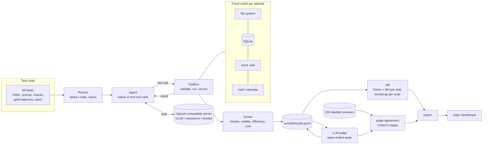

# trajeval

**An evaluation harness for tool-using LLM agents: it scores whole trajectories (the answer, the
tool calls and the cost), flags regressions between runs only when they are statistically real,
and checks its LLM judge against labelled answers before trusting it.**

Everything here runs locally on a 4 GB laptop GPU (GTX 1650, no tensor cores): Qwen2.5 0.5B, 1.5B
and 3B, served by vLLM and by [nanoserve](https://github.com/9shrey/nanoserve), my own inference
engine.

**In short**, from 2,720 trajectories (5,393 LLM calls) over 68 tasks:

- **Small agents fail at tool use, not at writing.** When the harness makes the gold tool calls
  and the model only writes the answer, Qwen2.5-1.5B passes 82% of the deterministically graded
  tasks; as an agent it passes 21%. (0.5B: 71% vs 8%. 3B: 88% vs 26%.)
- **Valid calls can still be wrong.** Across the seven agent runs, the models made up 273 of the 274
  email and meeting recipient addresses they used. Those calls pass every schema check and
  *succeed*, so a validity metric alone never sees them.
- **Regression flags you could gate a deploy on.** Rerunning an identical config, the significance
  rule flagged 0 tasks where "any drop in pass rate" flagged 4. An injected outage collapsed 4 tasks
  from 5/5 to 0/5: the rule flagged exactly those 4 (precision 100%); the naive rule flagged 10, 3 of
  them false alarms.
- **The judge is measured before it is used.** On 200 labelled answers the best
  judges reach Cohen's kappa of about 0.3 on held-out tasks ("fair" agreement); a 0.5B judge passes
  75% of answers when 12% are correct (kappa 0.08). So open-ended pass rates below come with that
  error bar, and nothing is gated on them. *The 200 labels were drafted by Claude (an LLM) and then
  reviewed by me, not blind; see [labels/](labels/README.md).*

**Dashboard:** [9shrey.github.io/trajeval](https://9shrey.github.io/trajeval/) · every number below is regenerated from `runs/` by `trajeval export`.

## What it does



- **A world the model can't answer from memory.** Kestrel Cycles is a fictional Bengaluru e-bike
  company: 15 files (policies, incident reports, logs, invoices, code), a SQLite database (30
  customers, 60 orders, 14 employees, 20 tickets), 15 web pages, a mail outbox and a calendar.
  Every fact is invented, so a correct answer requires using the tools.
- **68 tasks in five kinds.** Lookups (14), multi-step chains across tools (20), actions that change
  the world (8), traps where the right move is to say "not found" or not act (6), and open-ended
  writing graded by a judge (20). Every task has a gold trajectory; a test replays all 68 against a
  fresh world and checks that the gold answer passes, so every task is solvable and every checker
  accepts a correct answer.
- **The environment keeps the record, not the agent.** Every call goes through `ToolEnv.call`,
  which validates arguments against a JSON schema, runs the tool and records the outcome. Any agent
  framework is scored the same way as long as its tool calls go through the env.
- **Two ways to call tools.** `native` sends `tools=[...]` and lets the server parse calls (vLLM's
  hermes parser, hosted APIs). `text` renders the tools into the prompt in Qwen2.5's own format
  (byte-identical to its Jinja chat template; a test checks this) and parses `<tool_call>` tags
  itself, which works on servers with no `tools` parameter, like nanoserve.

## What a trajectory is scored on

| metric | definition |
|---|---|
| correct | deterministic checks on the answer and the final world (numbers within tolerance, required strings, files written, emails sent, meetings booked, nothing sent when told not to), or the judge for open-ended tasks |
| invalid calls | hallucinated tool names, arguments that break the schema, calls that could not be parsed. A valid call that fails (file not found, SQL error) is a separate `tool_error` |
| invented recipients | email or meeting addresses that never appeared in the prompt or an earlier tool result. These calls are schema-valid and *succeed*, so validity checks miss them |
| redundant calls | the same tool with the same arguments and no side effect in between, so the answer cannot have changed |
| loops | the same call three or more times in one trajectory |
| ran past its turn | the model kept generating after its tool call and invented the tool's result or the user's next message. The text agent cuts the turn there, never feeds the invention back, and counts it |
| efficiency | (gold calls + 1) / (calls + 1), capped at 1, on passed trajectories |
| unrequested side effects | emails, files or meetings created on a task that did not ask for one |
| cost | prompt and completion tokens, wall-clock time per trajectory and per LLM call; dollars when a price is configured |

## Results

GTX 1650 Mobile (4 GB, no tensor cores). Every run uses temperature 0.7, top-p 0.8, top-k 20
(Qwen2.5's recommended sampling), at most 8 LLM turns and 512 output tokens per turn. Open-ended
tasks are graded by the default judge (Qwen2.5-3B with rubric and reference answer, see [the judge section](#the-judge-checked-before-it-is-trusted)
for how far to trust it); everything else by deterministic checks. Tables are generated by
`scripts/make_tables.py` from `runs/`.

<!-- table:runs -->
| run | model | server, tool parsing | prompt | trials | pass rate, checks only: 48 tasks (95% CI) | with judge: 68 tasks | lookup | multi-step | action | trap | open-ended (judge) | invalid calls | tokens / task | time p50 |
|---|---|---|---|---:|---|---:|---:|---:|---:|---:|---:|---:|---:|---:|
| `qwen3b-v1` | Qwen2.5-3B (AWQ) | vLLM, trajeval | v1 | 3 | **26.4%** (15%–38%) | 25.0% | 43% | 15% | 0% | 61% | 22% | 10.0% | 5,715 | 63 s |
| `qwen3b-native-v1` | Qwen2.5-3B (AWQ) | vLLM, server (hermes) | v1 | 3 | **26.4%** (15%–38%) | 23.0% | 43% | 15% | 0% | 61% | 15% | 17.4% | 4,785 | 52 s |
| `qwen1.5b-v2` | Qwen2.5-1.5B (AWQ) | vLLM, trajeval | v2 | 5 | **20.8%** (11%–32%) | 19.3% | 39% | 7% | 0% | 53% | 15% | 6.8% | 3,409 | 23 s |
| `qwen1.5b-v2-rerun` | Qwen2.5-1.5B (AWQ) | vLLM, trajeval | v2 | 5 | **20.0%** (11%–30%) | 20.4% | 34% | 7% | 0% | 57% | 21% | 5.2% | 3,479 | 21 s |
| `qwen1.5b-v2-faults` | Qwen2.5-1.5B (AWQ) | vLLM, trajeval | v2 + faults | 5 | **9.6%** (3%–17%) | 13.0% | 6% | 5% | 0% | 47% | 21% | 6.5% | 3,212 | 21 s |
| `qwen1.5b-v1` | Qwen2.5-1.5B (AWQ) | vLLM, trajeval | v1 | 5 | **21.7%** (12%–34%) | 21.2% | 31% | 7% | 0% | 77% | 20% | 6.9% | 3,041 | 20 s |
| `qwen0.5b-v1` | Qwen2.5-0.5B | nanoserve, trajeval | v1 | 5 | **8.3%** (2%–16%) | 10.3% | 16% | 1% | 0% | 27% | 15% | 26.7% | 2,595 | 36 s |
| `qwen3b-goldpath` | Qwen2.5-3B (AWQ) | vLLM, gold path (diagnostic) | v1 | 3 | **88.2%** (80%–96%) | – | 86% | 83% | 100% | 94% | – | – | 2,006 | 40 s |
| `qwen1.5b-goldpath` | Qwen2.5-1.5B (AWQ) | vLLM, gold path (diagnostic) | v1 | 3 | **81.9%** (72%–92%) | – | 86% | 77% | 100% | 67% | – | – | 2,028 | 15 s |
| `qwen0.5b-goldpath` | Qwen2.5-0.5B | nanoserve, gold path (diagnostic) | v1 | 3 | **70.8%** (60%–82%) | – | 86% | 55% | 100% | 50% | – | – | 3,620 | 33 s |
<!-- /table:runs -->

- **Pass rates are low and that is the point of measuring.** The suite needs a schema lookup, a
  join, or a file read for most answers, and these models mostly guess instead. Gold-path runs
  (the harness makes the calls, the model answers) show the gap is tool use: the 1.5B model goes from
  21% to 82% on the same tasks. The diagnostic separates "can't find it" from "can't say it".
- **Actions are 0% for every agent run**: the email, file and meeting tasks need a name looked up
  first, and the models invent the address instead (next table).
- **The prompt matters less than expected on average and more on single tasks.** Prompt v2 says where
  each kind of data lives; v1 does not. The suite-level change is +0.8 points (not significant), but
  one task collapsed from 5/5 to 0/5 under v1: without being told that orders live in SQL, the
  model searched the *files* for "cancelled", found nothing and answered "no orders were cancelled".

### Tool-call validity and side effects

<!-- table:validity -->
| run | tool calls / task | hallucinated tool | schema error | malformed | tool error (valid call) | invented recipient addresses | ran past its turn | loops | hit 8-turn limit | unrequested side effects |
|---|---:|---:|---:|---:|---:|---:|---:|---:|---:|---:|
| `qwen3b-v1` | 2.80 | 0.5% | 1.0% | 8.4% | 28.5% | 59 of 60 | 9.8% | 10.3% | 7.8% | 37 |
| `qwen3b-native-v1` | 2.48 | 0.0% | 0.0% | 17.4% | 24.3% | 53 of 53 | 0.0% | 6.9% | 4.9% | 33 |
| `qwen1.5b-v2` | 1.04 | 0.0% | 0.0% | 6.8% | 40.3% | 29 of 29 | 0.0% | 2.9% | 0.6% | 5 |
| `qwen1.5b-v2-rerun` | 1.08 | 0.0% | 0.0% | 5.2% | 40.7% | 29 of 29 | 0.3% | 2.1% | 0.3% | 3 |
| `qwen1.5b-v2-faults` | 0.95 | 0.0% | 0.3% | 6.2% | 54.5% | 32 of 32 | 0.0% | 1.5% | 0.3% | 3 |
| `qwen1.5b-v1` | 1.03 | 1.1% | 0.6% | 5.1% | 16.3% | 35 of 35 | 0.0% | 1.5% | 0.9% | 4 |
| `qwen0.5b-v1` | 0.76 | 6.2% | 16.7% | 3.9% | 22.9% | 36 of 36 | 0.3% | 0.3% | 0.3% | 13 |
<!-- /table:validity -->

- **The 0.5B model's calls are often invalid** (16% schema errors, 7% calls to tools that do not
  exist); the 1.5B and 3B models' calls are mostly valid (5-10% malformed), and they fail in subtler
  ways: invented arguments, giving up after one empty search, or announcing a next step and then
  stopping.
- **The serving stack is part of the agent.** The same 3B model, prompt and seeds: through vLLM's
  hermes tool parser, 17.4% of attempted calls were unparseable; through trajeval's parser, 8.4%. vLLM
  rejects `{"name": "get_db_schema"}` because the `arguments` key is missing, returns it as plain
  text, and an OpenAI client treats that text as the final answer. Same pass rate here, different
  failure mode.
- **Ran past its turn**: 10% of the 3B model's trajectories contain a turn where it kept writing
  after its tool call and invented the tool's result (`<tool_response>15</tool_response>`) or the
  user's next message. The text agent cuts the turn there and never feeds the invention back.

## Regressions: when is a drop real?

Sampled agents are noisy. Run the same configuration twice and many tasks will score lower the
second time by chance. `trajeval diff` therefore runs every task several times on each side and
flags a task only when the drop is unlikely to be noise:

1. **Per task:** a one-sided Fisher exact test on the pass counts (k trials each side), written
   out from the hypergeometric distribution and checked against SciPy in the tests.
2. **Across tasks:** Benjamini-Hochberg correction over every task in the comparison (the 48
   deterministically graded ones when gating, see below) at a false discovery rate of 0.10. A task that survives is **regressed** (`--fail-on-regression` exits 1 for CI). Uncorrected
   p < 0.05 is shown as **suspect**: worth reading, not enough to fail a build.
3. **Suite level:** the mean change in per-task pass rate, with a bootstrap interval that
   resamples *tasks*, because trials of one task are correlated and resampling trajectories would
   understate the error.

**How many trials do you need?** Exact power of the per-task test, by enumerating every outcome
(`scripts/power.py`):

| trials per side | 100% → 0% | 90% → 10% | 90% → 50% | 80% → 40% | 60% → 30% |
|---:|---:|---:|---:|---:|---:|
| 3 | 100% / 0% | 53% / 0% | 9% / 0% | 11% / 0% | 7% / 0% |
| 5 | 100% / 0% | 74% / 0% | 12% / 0% | 14% / 0% | 8% / 0% |
| 10 | 100% / 100% | 99% / 72% | 47% / 6% | 42% / 6% | 25% / 2% |
| 20 | 100% / 100% | 100% / 100% | 84% / 37% | 75% / 31% | 46% / 12% |
| 40 | 100% / 100% | 100% / 100% | 99% / 85% | 97% / 75% | 80% / 37% |

Each cell is *uncorrected p < 0.05* / *a lone regression surviving BH across 48 tasks*. The second
number is the sobering one: with 5 trials the smallest possible p-value is 1/252 = 0.004, above
0.10/48 = 0.002, so **a single regressed task can never be flagged**. Several tasks collapsing
together (a broken tool, a bad prompt) can be, because BH relaxes the threshold as discoveries
accumulate: two total collapses at once clear it (0.10 x 2/48 = 0.0042). Catching one task going
from 90% to 50% takes about 40 trials a side. That is why the suite-level interval matters more than per-task flags at small k.

### What the detector did on real runs

<!-- table:diffs -->
| comparison | suite change in pass rate (95% CI) | regressed (Fisher + BH) | improved | suspect (p < 0.05) | naive: any drop |
|---|---|---:|---:|---:|---:|
| A/A: identical config, new seed (`qwen1.5b-v2` → `qwen1.5b-v2-rerun`) | -0.8 pts (-4.6 to +2.1, n.s.) | 0 | 0 | 0 | 4 |
| Injected outage: SQL database, web search and FX service down (`qwen1.5b-v2` → `qwen1.5b-v2-faults`) | -11.2 pts (-20.4 to -3.3) | 4 | 0 | 1 | 10 |
| Prompt simplified: v2 -> v1 (`qwen1.5b-v2` → `qwen1.5b-v1`) | +0.8 pts (-7.9 to +9.6, n.s.) | 0 | 0 | 1 | 8 |
| Downgrade 3B -> 1.5B (`qwen3b-v1` → `qwen1.5b-v1`) | -4.7 pts (-15.4 to +6.0, n.s.) | 0 | 0 | 3 | 9 |
| Downgrade 1.5B -> 0.5B (nanoserve) (`qwen1.5b-v1` → `qwen0.5b-v1`) | -13.3 pts (-22.5 to -5.8) | 2 | 0 | 3 | 10 |
| Same 3B model, tool calls parsed by vLLM instead of trajeval (`qwen3b-v1` → `qwen3b-native-v1`) | -0.0 pts (-3.5 to +3.5, n.s.) | 0 | 0 | 0 | 3 |
<!-- /table:diffs -->

<!-- table:detector -->
Faults touch 32 tasks (gold-trajectory replay); 6 of them passed at least 60% of baseline trials, so a drop there is detectable.

| rule | flagged | caught (of detectable) | false alarms (untouched tasks) | precision |
|---|---:|---:|---:|---:|
| Fisher + BH (q ≤ 0.10) | 4 | 4 of 6 | 0 of 16 | 100% |
| Fisher, uncorrected p < 0.05 | 5 | 5 of 6 | 0 of 16 | 100% |
| any drop in pass rate | 10 | 6 of 6 | 3 of 16 | 70% |
<!-- /table:detector -->

The comparisons use the 48 deterministically graded tasks (`diff --checker-only`). Open-ended tasks
are graded by a judge whose agreement with labels is far from perfect (below), and a CI gate should
not fail a build on another model's noisy opinion; judge noise would also blur what these
experiments measure, which is the detector.

- **A/A** (same config, new seed): 4 tasks scored lower by chance; none came close to significance,
  and the suite interval straddles zero. A naive gate would have blocked an unchanged system.
- **Injected outage** (`break:sql_query`, `break:web_search`, `break:convert_currency`): replaying the
  gold trajectories says the outage touches 32 of the 48 tasks, but most were 0/5 already. Six had
  something to lose (baseline at least 3/5). The rule flagged the four that went 5/5 to 0/5 and
  nothing else. It missed the 4/5 to 0/5 and 3/5 to 0/5 tasks, exactly as the power table predicts
  for 5 trials (p = 0.024 and 0.083 before correction).
- **Downgrades** 3B to 1.5B and 1.5B to 0.5B: the first is not significant at suite level (-4.7
  points, interval -15.4 to +6.0); the second is (-13.3, -22.5 to -5.8), with two tasks flagged.

## The judge: checked before it is trusted

Open-ended tasks (summaries, customer replies, briefs) are graded by an LLM judge against a
per-task rubric, optionally with a reference answer. Before any judge grades a run, it is measured
against 200 labelled answers (`labels/`):

- The samples come from the runs themselves, 10 per open-ended task, across models.
- The split is by **task**: the judge prompt was iterated on the 10 dev tasks; the 10 test tasks
  were held out, so the reported kappa is not tuned to them.
- Agreement is Cohen's kappa with a bootstrap interval, plus the confusion matrix, because
  accuracy alone hides a judge that passes everything when most answers pass.
- Small agents rarely write a correct open-ended answer, so half of each task's samples come from
  gold-path runs (the harness makes the right tool calls, the model writes the answer). Even so,
  24 of 200 samples pass: every interval below is wide.

**Who labelled them.** Claude, an LLM, drafted all 200 labels (`labels/labels_claude.jsonl`)
following the written rule in [labels/README.md](labels/README.md), each with a one-line rationale
(8 marked borderline). I then reviewed all 200 against the same rule and changed none
(`labels/labels_human.jsonl`). The review was not blind: I saw Claude's label next to each answer,
so it confirms the labels rather than adding an independent second annotation, and the set has no
human-human agreement figure yet. `trajeval label` runs a blind review (you decide before seeing
the draft label), which is how a second annotator should be added.

<!-- table:judge -->
| judge | sees | dev kappa (95% CI) | test kappa (95% CI) | test accuracy | test confusion [label pass: judge pass, fail / label fail: judge pass, fail] | judge pass rate vs label (test) |
|---|---|---|---|---:|---|---|
| Qwen2.5-3B (AWQ) | rubric | 0.20 (0.08 to 0.33) | **0.34 (0.15 to 0.53)** | 76% | 10, 2 / 22, 66 | 32% vs 12% |
| Qwen2.5-3B (AWQ) | rubric + reference | 0.25 (0.07 to 0.42) | **0.30 (0.07 to 0.53)** | 80% | 7, 5 / 15, 73 | 22% vs 12% |
| Qwen2.5-3B (AWQ) | rubric + reference, v2 prompt (evidence first) | 0.20 (-0.06 to 0.45) | **0.37 (0.00 to 0.66)** | 91% | 3, 9 / 0, 88 | 3% vs 12% |
| Qwen2.5-1.5B (AWQ) | rubric | 0.16 (0.05 to 0.29) | **0.30 (0.14 to 0.47)** | 71% | 11, 1 / 28, 60 | 39% vs 12% |
| Qwen2.5-1.5B (AWQ) | rubric + reference | 0.13 (0.00 to 0.26) | **0.30 (0.10 to 0.49)** | 75% | 9, 3 / 22, 66 | 31% vs 12% |
| Qwen2.5-0.5B | rubric + reference | 0.03 (-0.02 to 0.08) | **0.13 (0.06 to 0.21)** | 45% | 12, 0 / 55, 33 | 67% vs 12% |
<!-- /table:judge -->

- **Size helps, a little.** Held-out kappa goes from 0.13 (0.5B) to about 0.3 (1.5B and 3B), all
  in the "fair" band, with intervals so wide (12 passing answers per split) that the 1.5B and 3B
  judges cannot be told apart.
- **The small judge is a yes-man.** The 0.5B judge passes 75% of answers when 12% are correct. It
  catches 23 of the 24 good answers and is still nearly useless: the case kappa exists to expose.
- **Prompting changed the bias, not the skill.** After reading the dev-split disagreements (v1 judges
  passed raw tool calls and "I have sent the email" non-answers, usually with no reasoning) I wrote
  a v2 prompt that makes the judge quote evidence for each rubric point and lists automatic
  failures. Its pass rate fell from 35% to 14% on dev (labels: 12%) and accuracy rose from 71% to
  82%, but kappa did not move (0.25 vs 0.21 on dev): it now fails good answers instead of passing
  bad ones. On test it passes only 3% of answers.
- **Default judge**: chosen by dev kappa, as fixed in `experiments.yaml` before the comparison:
  Qwen2.5-3B, rubric plus reference (v1), test kappa 0.30. It is lenient (passes 22% of test answers
  vs 12%), so the open-ended column in the results table overstates quality. That is why regression
  gating uses deterministic tasks only.

## Reproduce

```bash
pip install -e ".[dev]" && pytest -q          # 157 tests, no GPU needed
python scripts/reproduce.py                    # every run, judge and export (GPU, hours)
```

`reproduce.py` reads `experiments.yaml`, brings up one model server at a time (vLLM in its own
venv, nanoserve for the 0.5B model), runs what needs it, shuts it down, and resumes from finished
trajectories if interrupted. Single pieces:

```bash
trajeval run --run-id my-run --agent text --model qwen2.5-1.5b-awq --base-url http://127.0.0.1:8100/v1
trajeval judge my-run --config rubric+ref --model qwen2.5-3b-awq
trajeval diff qwen1.5b-v2 my-run --checker-only --fail-on-regression
trajeval report my-run
trajeval export && python -m http.server -d dashboard
```

Any OpenAI-compatible endpoint works; set `TRAJEVAL_API_KEY` for a hosted one and pass
`--price '{"input": 0.15, "output": 0.6}'` to get dollars per task.

## What I'd do next

1. **Sequential testing instead of fixed k.** Most tasks are 0/k or k/k; spend trials only where the
   result is ambiguous (SPRT or a Bayesian stopping rule). Same power for a fraction of the GPU time.
2. **A blind second annotator** (`trajeval label` runs blind by default). My review of the labels
   saw the drafts, so there is no independent inter-annotator kappa yet: the ceiling a judge's kappa
   should be compared against.
3. **A frontier model as agent and as judge.** The small local models put most tasks at 0%;
   a stronger agent would make per-task regression tests far more informative.
4. **Rubric points scored separately** instead of one pass/fail verdict, so a judge disagreement can
   be traced to the point it misread.
5. **A LangGraph adapter.** The environment already records every call, so it is a thin wrapper that
   routes the graph's tool node through `ToolEnv.call`.
6. **Stop sequences at the server** for role tokens, so a runaway turn costs no decode time instead of
   being cut after the fact.

## Layout

```
trajeval/
  tools/base.py      Tool, ToolEnv (validation, call record), ToolCall
  tools/world.py     the Kestrel world, 12 tools, fault injection
  tasks.py           suite loading and checkers
  agents/            native and text tool-calling loops, Qwen tool format, parser
  runner.py          tasks x trials, fresh world per attempt, async, resumable
  scoring.py         per-trajectory metrics
  diff.py stats.py   regression rule, Fisher, BH, bootstrap, kappa (by hand, tested against SciPy)
  judge.py labels.py LLM judge configs, labelled samples, agreement, review CLI
  faults.py          which tasks a fault touches (gold-trajectory replay)
  export.py          dashboard data
tasks/kestrel.yaml   the 68 tasks
experiments.yaml     every run, comparison and judge behind this README
runs/                results.jsonl.gz per run (+ judgments/); `trajeval pack` compresses
scripts/             reproduce.py, server.py, power.py, make_tables.py, serve_vllm.sh
labels/              samples, labels, judge verdicts
dashboard/           static site (GitHub Pages)
```
